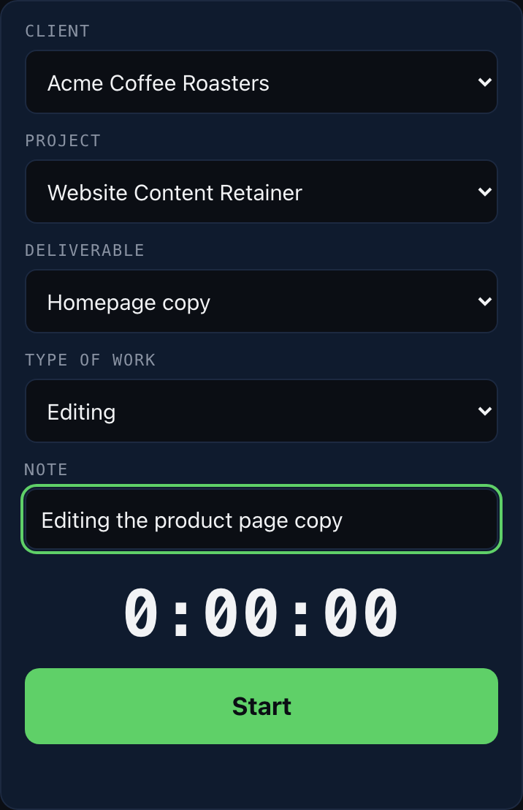
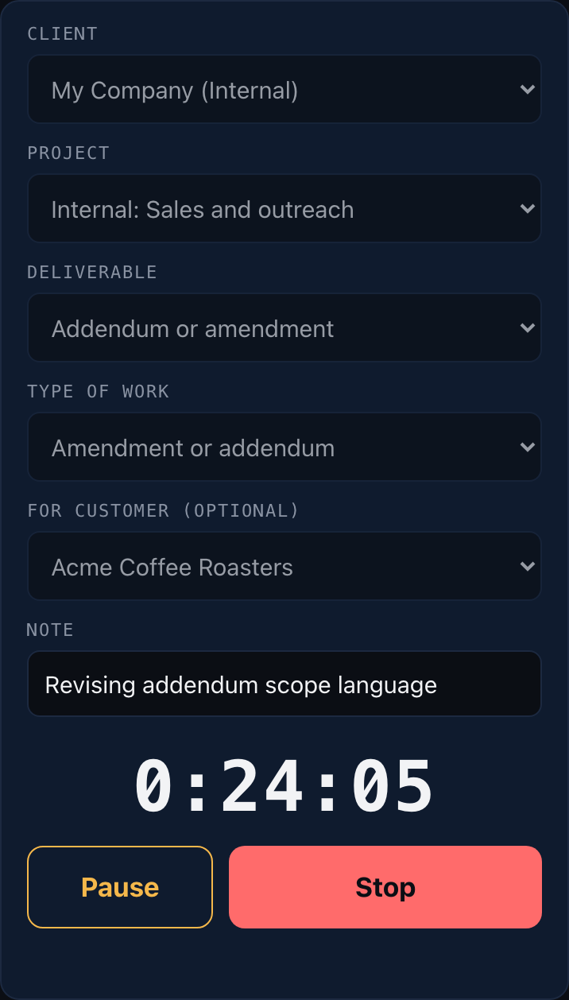
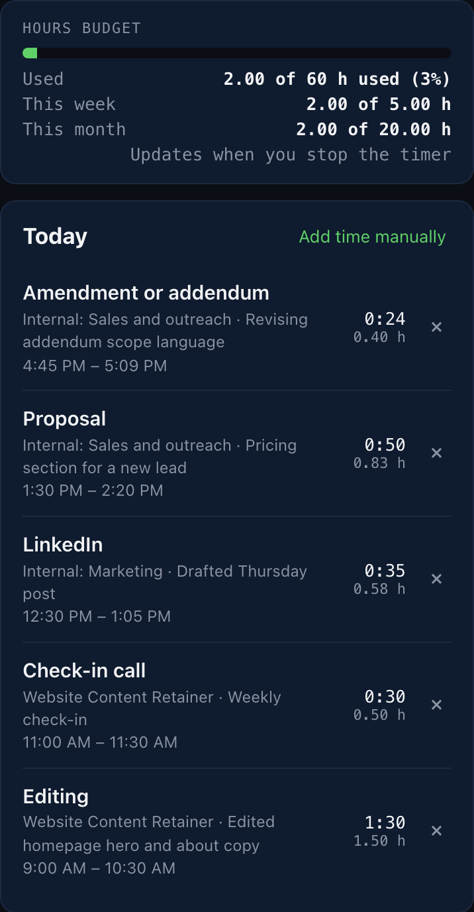

# User guide

This guide covers daily use. To build your own copy first, see the [setup guide](setup.md).

## The screen at a glance

| Area | What it shows |
| --- | --- |
| Two totals at the top | Time logged today for the selected **client**, and for **all work** |
| Pickers | **Client**, **Project**, **Deliverable**, **Type of work** (and **For customer** on internal projects) |
| Note | One line about what you are doing |
| Clock and buttons | The running time, **Pause or Resume**, and **Start or Stop** |
| Hours budget | Used, this week and this month against the limits, plus any warning flags |
| Today | Every entry for today, with a delete button |

## Log time with the timer

1. Choose the **client**, then the **project**. The project list only shows that client's projects.
2. Choose a **deliverable** if the work belongs to one (optional), and the **type of work** (required).
3. Add a short **note** if you like.
4. Press **Start**. The entry is saved to Airtable immediately, so a crash or a reload never loses a running timer.
5. Press **Stop** when you are done. The budget panel refreshes.

Only one timer runs at a time. While it runs, the pickers lock so an entry cannot change what it belongs to halfway through.

## Pause and resume

Use **Pause** when you step away mid-task, such as a walk or a meal, and you want to keep working on the same thing afterward.

1. With a timer running, press **Pause**. The clock freezes and turns amber. The button changes to **Resume**.
2. When you are back, press **Resume**. The clock continues from where it stopped.
3. If you press **Stop** while paused, the paused stretch is not counted. The entry ends at the time you stop, minus every pause.

What stays the same across a pause: the project, deliverable, type of work and your note. You do not retype anything.

Things worth knowing:

- A paused timer is still **the one running timer**. You cannot start another until you stop it.
- You can pause as many times as you like on one entry. The app adds the pauses together.
- Pauses are **not** counted toward your included hours, caps or statements.
- Pause works offline. It is queued and synced like any other change.
- A timer left paused for a long time still shows as running in Airtable. The data check formula flags an entry with no end after 12 hours so you can find and close it. [Why pause is designed this way](why-it-works-this-way.md#why-pause-adjusts-one-entry-instead-of-splitting-it).

## Add time you forgot to track

1. Choose the client, project, deliverable and type of work, as for the timer.
2. Press **Add time manually**, then enter the start and end.
3. Press **Add entry**. It is marked `Manual` in Airtable.

## Delete an entry

Press the **×** beside an entry in the Today list and confirm. Only today's entries are listed. Edit older ones in Airtable.

## Log internal work

Internal work is anything you do not bill to a client, such as sales, marketing, learning or building your own tools. It uses the same screen.

1. Pick your **internal client** (for example "My Company (Internal)"), then an **internal project** (for example "Internal: Sales and outreach").
2. Pick a deliverable and a type of work. Internal projects offer the task types marked for internal use.
3. Internal projects round to the minute by default, so your own time is counted exactly.

### Tag the customer an internal task is for

Sometimes unbilled work exists because of a customer: you are writing their addendum, preparing their proposal, or researching their industry. That time should not count against their retainer, but you do want to know what that customer costs you in effort.

If your copy has the optional **Related Client** field enabled, internal projects show a **For customer** picker. Choose the customer and the entry is tagged. The hours stay internal, and your reports can group them by customer. See [why this field exists](why-it-works-this-way.md#why-internal-work-can-point-at-a-customer) and [how to enable it](customizing.md#publicconfigjs).

## Work offline

If the connection drops, the app keeps working. New entries, pauses and stops are stored on your device and sent when you are back online. The header shows **Offline** and how many changes are waiting. Each entry carries a unique ID, so reconnecting never creates duplicates.

## Read the hours budget

If the selected project has included hours or caps, the panel shows:

- **Used:** hours counted so far, against the included total.
- **This week** and **This month:** against any weekly or monthly cap.
- **Flags:** a warning at 75%, 90% and 100% of included hours, and near and reached for caps.

The panel shows Airtable's numbers and refreshes when you stop the timer, not while it runs.

## How hours are counted

- Each entry is rounded to the project's **rounding increment**. The default is the nearest 15 minutes (so 7 minutes counts as 0 and 8 minutes counts as 15). Internal projects typically use 1 minute.
- Rounding happens **once per entry**, after pauses are removed.
- Entries under one minute count as zero.

Details and the reasons behind them: [Why it works this way](why-it-works-this-way.md#why-rounding-is-per-entry-and-per-project).

## Send a monthly statement

The optional statement script turns a month of entries into a one-page Word document. See [customizing](customizing.md#monthly-client-statements).

## When something looks wrong

See [Troubleshooting](troubleshooting.md).
